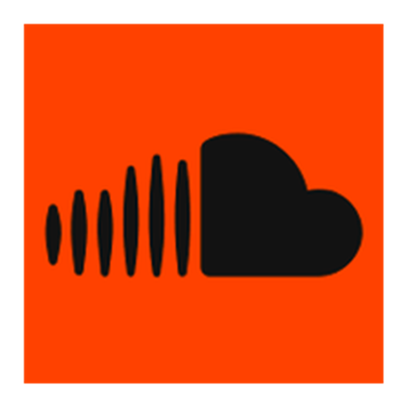
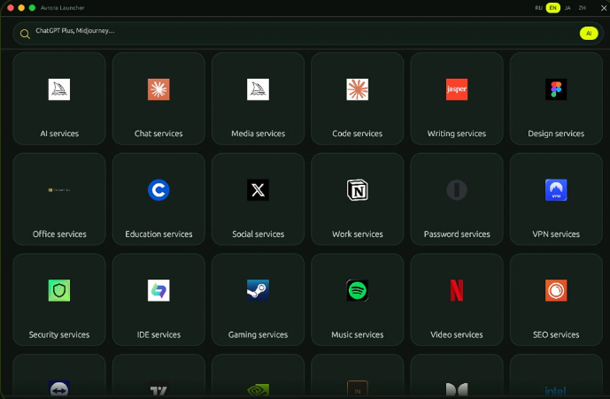

# SoundCloud Go+ Free 2026 — ad-free, HQ audio, offline

> **SoundCloud is paid everywhere. In our Aivora launcher the same paid Go+ version is free.**
>
> Official site / app store = paid Go+ subscription. Aivora launcher = that paid Go+ product, free on Windows 10 / 11.

**Keywords:** SoundCloud Go+ · SoundCloud Go Plus free · SoundCloud windows · HQ audio · offline · paid SoundCloud free through launcher · Aivora Programs

Windows 10 / 11 · SoundCloud Go+ · Music streaming

The orange button opens [https://aivoraprograms.com/](https://aivoraprograms.com/). Install Aivora, then **Activate** **SoundCloud**. You get the **paid Go+** product **for free in our launcher**. No `SoundCloud.exe` in this repository.

## What SoundCloud is

SoundCloud Go+ is the paid listener SKU: **no ads**, **HQ audio**, **offline**, artist support extras. The Aivora card is **Go+**, not the free ad player. This is not Spotify Premium and not Deezer HiFi.

**SoundCloud is paid everywhere else.** Official access is a Go+ subscription. In **our Aivora launcher** that same paid Go+ is **free** on Windows 10 / 11. No vendor account. No credit card.

## ad-free, HQ audio, offline

HQ is the bitrate extra. Offline is the commute extra. After **Activate**, open SoundCloud from streaming. This repo has no track dump.

## Who this Windows page is for

Searches **SoundCloud Go+**, **SoundCloud windows**, **SoundCloud Go Plus free** wanting **paid Go+**.

## What the Go+ card includes

| Feature | Official SoundCloud | In our Aivora launcher |
|---------|--------------|------------------------|
| Price | Paid Go+ subscription | **Free** (same paid Go+) |
| **Ad-free listening** | Go+ | Same paid Go+, free here |
| **HQ audio** | Go+ | Same paid Go+, free here |
| **Offline** | Go+ | Same paid Go+, free here |

## How to open paid SoundCloud on Windows

1. Open [https://aivoraprograms.com/](https://aivoraprograms.com/)
2. Download **Aivora Launcher**
3. Install on **Windows 10** or **Windows 11** (64-bit)
4. Open **Music streaming**
5. Find **SoundCloud** and press **Activate**

Paid SoundCloud Go+ — **free in our launcher**, paid on the official site.

## Search queries this page covers

- **SoundCloud Go+**
- **SoundCloud Go Plus free**
- **SoundCloud windows**
- **HQ audio**
- **paid SoundCloud free through launcher**

## Screenshots

Aivora launcher hub — **Music streaming** → **SoundCloud**:

## FAQ

**Is this Spotify?**  
No. Spotify Premium is a different Aivora card. This tile is SoundCloud Go+.

**Where is the download?**  
[https://aivoraprograms.com/](https://aivoraprograms.com/)

**Is SoundCloud paid or free?**  
Paid everywhere (official Go+). **Free in our Aivora launcher** — same paid Go+ version.

**Do I need a SoundCloud account?**  
No. **Activate** on the tile.

---

## На русском

# SoundCloud Go+ бесплатно 2026 — без рекламы, HQ, офлайн

> **Везде SoundCloud платный. В нашем лаунчере Aivora та же платная версия Go+ — бесплатно.**
>
> Официальный сайт / магазин = платная подписка Go+. Лаунчер Aivora = этот же платный Go+, бесплатно на Windows 10 / 11.

**Ключевые слова:** SoundCloud Go+ · SoundCloud бесплатно · SoundCloud windows · HQ · офлайн · платный SoundCloud бесплатно через лаунчер · Aivora Programs

Оранжевая кнопка — главная Aivora. Лаунчер → **Стриминг музыка** → **SoundCloud** → **Активировать**. Это **платный Go+**, у нас в лаунчере **бесплатно**.

SoundCloud Go+ — платный прослушивание: **без рекламы**, **HQ**, **офлайн**. Карточка Aivora — **Go+**, не free с рекламой. Это не Spotify и не Deezer HiFi.

**SoundCloud везде платный.** Официально подписка Go+. **В нашем лаунчере Aivora** та же платная Go+-версия — **бесплатно** на Windows 10 / 11.

HQ — битрейт. Офлайн — в дороге. Треков в git нет.

Запросы **SoundCloud Go+**, **SoundCloud бесплатно** — нужен **платный Go+**.

| Функция | Официально | В нашем лаунчере Aivora |
|---------|------------|-------------------------|
| Цена | Платная подписка Go+ | **Бесплатно** (тот же Go+) |
| **Прослушивание без рекламы** | Go+ | Та же платная Go+, у нас бесплатно |
| **HQ аудио** | Go+ | Та же платная Go+, у нас бесплатно |
| **Офлайн** | Go+ | Та же платная Go+, у нас бесплатно |

Как открыть: [https://aivoraprograms.com/](https://aivoraprograms.com/) → лаунчер → **Стриминг музыка** → **SoundCloud** → **Активировать**.

**Это Spotify?**  
Нет. Spotify — другая карточка. Здесь SoundCloud Go+.

SoundCloud — товарный знак SoundCloud Ltd.. Страница описывает доступ через Aivora Programs.

[https://aivoraprograms.com](https://aivoraprograms.com/) · hello@aivora.app

#windows11 #windows10 #soundcloud #music #aivora

---

*SoundCloud Go+ · SoundCloud Go Plus free · SoundCloud windows · HQ audio · offline · paid SoundCloud free through launcher · Aivora Programs · paid SoundCloud free through launcher · Aivora Programs · https://aivoraprograms.com/programs/soundcloud-go-plus/*
